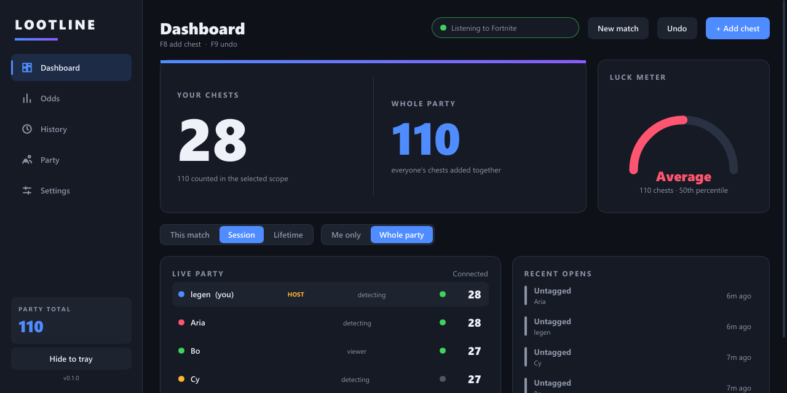
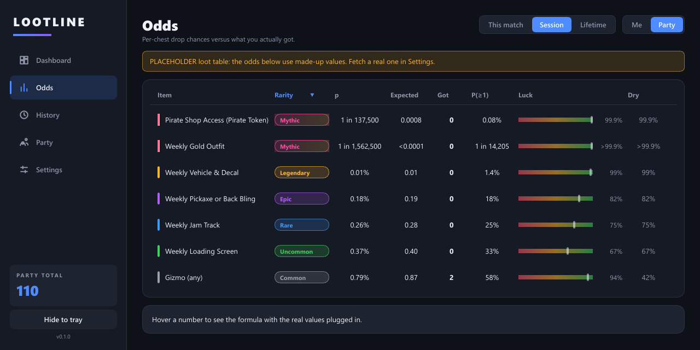
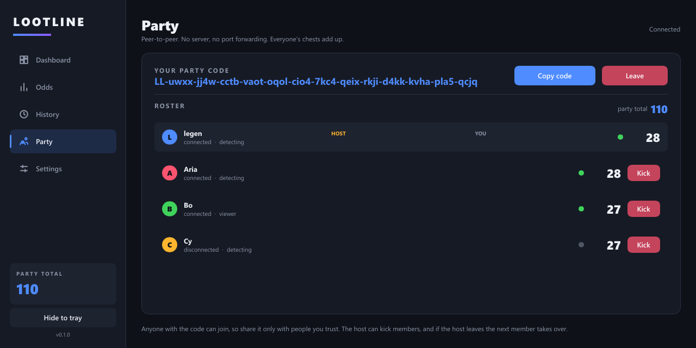

# Lootline

Fortnite chest tracker for you and your friends: counts chests opened, shows each item's per-chest
odds, your chance of having found it given how many chests you opened, and how lucky or unlucky the
party has been. Windows is the primary target; a Linux AppImage runs in viewer-only party mode.

 <!-- screenshot placeholder -->
 <!-- screenshot placeholder -->
 <!-- screenshot placeholder -->

## Features
- **Audio chest detection** (Windows): Fortnite-only process-loopback audio -> STFT (1024/512) -> 40-band
  log-mel -> sliding normalised cross-correlation against template files. Counts only if *your* interact
  key (default E) was held in the 1.5 s before the sound; 2 s debounce; sensitivity slider; runs on its own thread.
- **Templates** live in `templates/`, fetched from the repo, plus an in-app **Record template** tool.
- **Manual fallback**: global hotkeys, F8 add chest, F9 undo.
- **Rarity overlay**: borderless always-on-top, no-activate window with one-click Common..Mythic buttons and an
  item dropdown; auto-hides after 3 s (chest stays counted, rarity unknown). Position, size, timeout configurable.
- **Party** (iroh, peer to peer, no server, no port forwarding): host gets a copyable code, others paste it.
  Append-only event log merged by set union; newcomers and reconnects exchange what they are missing; host can kick;
  host leaving hands over to the next member. **The party total is the sum of everyone's chests.**
- **Odds**: per item and rarity, for this match / session / lifetime and me / party: expected = n·p,
  P(≥1) = 1−(1−p)^n, luck = Binomial CDF, dry streak = (1−p)^n. Hover any number for the formula with real values.
- **History** (sessions, matches, per-player, rarity bars), SQLite storage.
- **Themes**: 6 built in (Dark, Light, OLED Black, Storm, High Contrast, Ember), TOML files in the themes folder,
  in-app editor with live preview, import/export, themeable rarity colours with reset. Tray icon with chest count.

## Loot table
`loot_tables/<season>.json` is fetched from the repo, cached, with a bundled fallback. The bundled table holds the
per-chest rates (1 in N) for the weekly treasures, Pirate Token and Gizmo, **supplied by the project owner from a public odds
page; verify them**. Audio cannot tell what a chest contained, so which item you got is tagged by hand in the overlay.

## Anti-cheat safety (Easy Anti-Cheat)
Everything happens outside the game. Lootline **never**: opens a handle to the Fortnite process (no `OpenProcess`,
`ReadProcessMemory`, `WriteProcessMemory`), injects DLLs, hooks DirectX/rendering, sniffs packets, or sends/simulates input.
It **only** uses:
- `CreateToolhelp32Snapshot` to read process *names* and find Fortnite's PID (a system-wide listing; the process is not opened).
- The Windows 10 2004+ process-loopback audio API (`ActivateAudioInterfaceAsync`, via the `wasapi` crate) for that PID.
- `GetAsyncKeyState` polling for your own interact key, and `RegisterHotKey` (`global-hotkey`) for the hotkeys.
- Style flags on Lootline's *own* overlay window (no-activate, topmost).
The optional single-frame Windows Graphics Capture is not implemented. See `detect/src` (the only place these APIs appear).

## Build
```
cargo test --workspace            # core, detect, net, app unit tests
cargo run -p lootline --release
cargo test -p lootline-net --test party -- --ignored   # real two-peer iroh test (needs internet)
```
Linux: `cargo build -p lootline --release` (detect is compiled out; package as AppImage with linuxdeploy).
Developer aid: `LOOTLINE_DEMO=1` runs with a fake in-memory party; `LOOTLINE_PAGE=0..4` picks the start page.

## Renderer choice and performance
Slint's **software renderer** (winit backend) is used: no GPU context or driver allocations (idle RAM stays low),
the overlay cannot contend with the game for the GPU, and nothing redraws while idle. Glow effects are plain
rounded rings (the software renderer has no blur filters) and only animate while a Legendary/Mythic is highlighted.
The detector does about 94 small correlations per second (well under 1% of a core). The network thread and endpoint
are created only when you host or join. Measure idle memory with a release build; debug builds are much larger.

## Layout
`core` events, odds, loot tables, storage, themes, DSP (pure, tested) · `detect` Windows audio + keys · `net` iroh party · `app` Slint UI.

MIT licensed.
